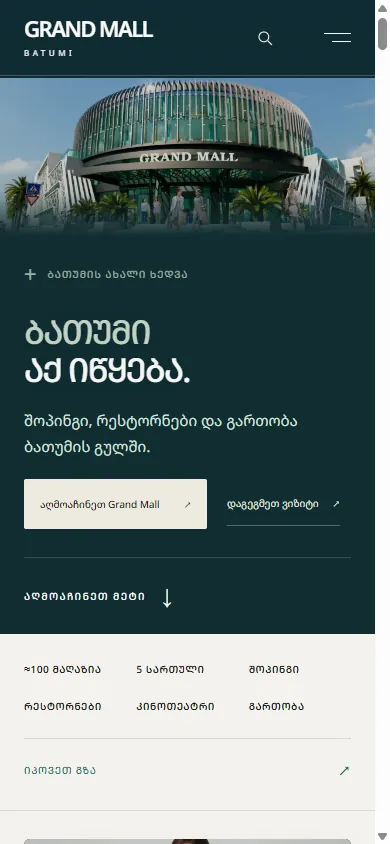
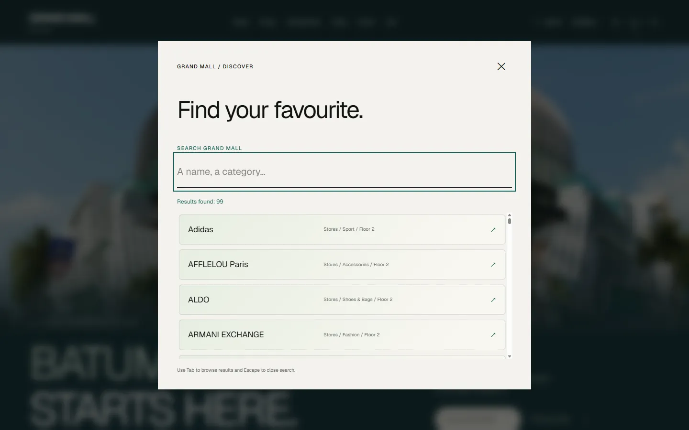
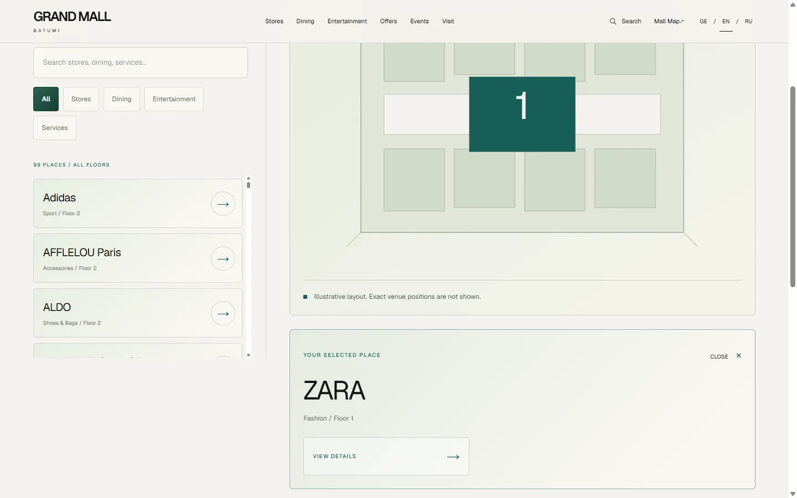
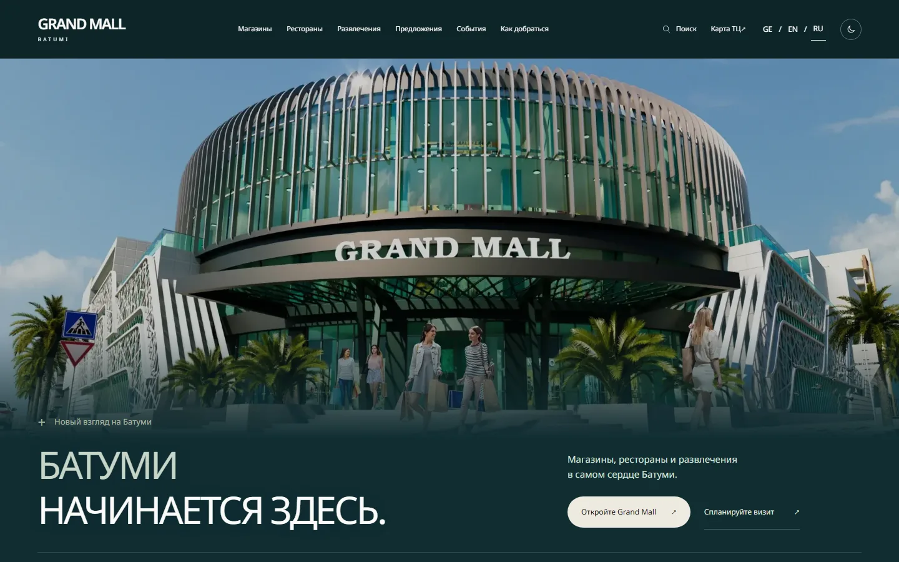
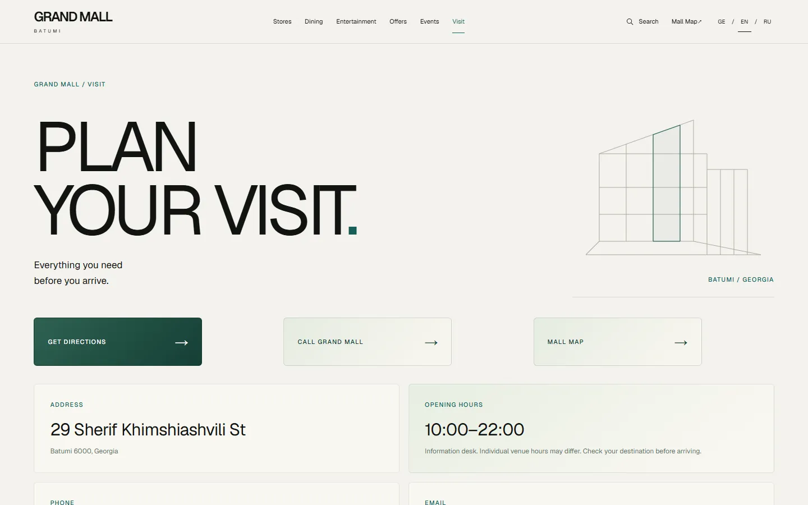
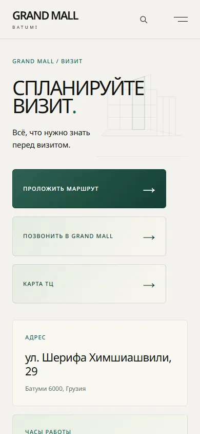

<div align="center">


<a href="https://grand-mall-three.vercel.app"></a>
<a href="docs/portfolio-qa-case-study.md"></a>
<a href="https://github.com/silestiari"></a>


</div>

> 💗 An independent portfolio project built alone in Sep–Oct 2026. It is **not** the official website of Grand Mall Batumi.

<p align="center">⋆｡ﾟ☁︎｡⋆｡ ﾟ☾ ﾟ｡⋆ &nbsp; =^･ω･^= &nbsp; ⋆｡ﾟ☁︎｡⋆｡ ﾟ☾ ﾟ｡⋆</p>

## 🛍️ About

A responsive website for a shopping mall in Batumi, Georgia, in three languages: English, Russian and Georgian. Visitors can search stores, filter by floor and category, find a place on the mall map and plan their visit. I designed, built and tested it: from page structure and copy to localization and a documented pre-launch QA pass.

## 📸 Screenshots

<table>
<tr>
<td colspan="2"></td>
<td rowspan="2" width="24%"></td>
</tr>
<tr>
<td></td>
<td></td>
</tr>
<tr>
<td></td>
<td></td>
<td></td>
</tr>
</table>

## ✨ Features

- 🔎 **Global search** across stores, dining and entertainment, case-insensitive, with an accessible results status
- 🏷️ **Store & dining directory** with floor and category filters that stay in the URL, so filtered views can be shared
- 🗺️ **Interactive mall map**: pick a place, the floor switches automatically; "Find on map" deep links from every store page
- 🌍 **EN / RU / KA**: the language switcher keeps the current page, slug, query and anchor
- 🌙 **Light & dark theme**, skip link, visible focus, reduced-motion support
- 🔗 **SEO**: localized metadata, canonical and hreflang tags, Open Graph, sitemap and robots
- 📄 **Honest data only**: no invented stores, hours or discounts; events and offers stay empty until verified

## 🧪 QA

Testing was part of the project from day one. The [final pre-launch QA report](docs/prelaunch-qa-final.md) (6 Oct 2026) records:

| | |
|---|---|
| 🖱️ Interaction checks (search, filters, map, navigation) | **151** |
| ♿ Axe accessibility checks on key pages | **48** |
| 🔗 Internal links returning HTTP 200 | **321** |
| 📱 Page × viewport combinations in 3 languages | **192** |
| 📏 Narrow-mobile checks at 320 px | **57** |

Plus Playwright end-to-end tests for critical user journeys in [`tests/`](tests/). Test scenarios, coverage areas and known limitations are in the **[QA case study](docs/portfolio-qa-case-study.md)**.

## 🚀 Run locally

```bash
npm install
npm run dev          # http://localhost:3000
```

| Command | What it does |
|---|---|
| `npm run lint` | ESLint |
| `npm run typecheck` | TypeScript check |
| `npm run build` | Production build |
| `npm test` | Playwright end-to-end tests |

Developer notes (in Russian): [docs/DEVELOPMENT.ru.md](docs/DEVELOPMENT.ru.md)

## 📁 Structure

```
app/[locale]/   pages for /en, /ru, /ka
components/     UI components
data/           stores, dining, entertainment (source-backed)
messages/       EN / RU / KA dictionaries
tests/          Playwright end-to-end tests
docs/           QA reports, case study, developer notes
```

<p align="center">⋆｡ﾟ☁︎｡⋆｡ ﾟ☾ ﾟ｡⋆ &nbsp; =^･ω･^= &nbsp; ⋆｡ﾟ☁︎｡⋆｡ ﾟ☾ ﾟ｡⋆</p>

<div align="center">

🎀 Made by **[Sofia Stetsiuk](https://github.com/silestiari)** — QA Engineer × Game Designer  
[Portfolio](https://sofia-stetsiuk-portfolio.vercel.app/en) · [Telegram](https://t.me/silestiari)

</div>
